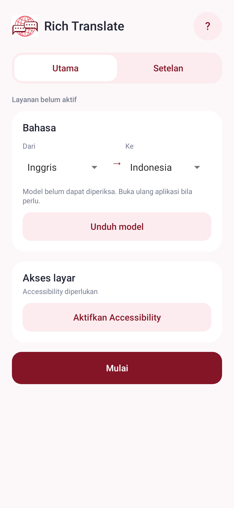
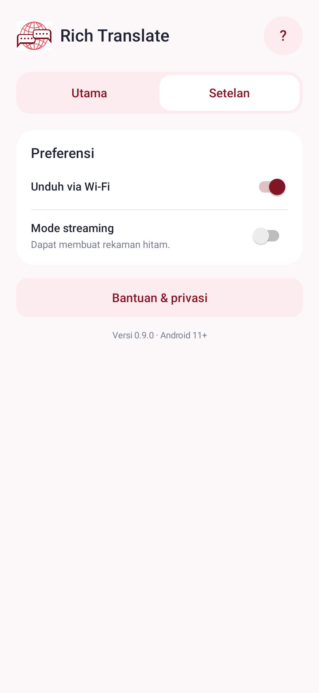

# Rich Translate

Penerjemah teks game/layar Android **11+**, menggunakan OCR Latin dan Google ML Kit. Default **Inggris → Indonesia**. Terjemahan berjalan offline setelah model bahasa diunduh.

**[Unduh APK v0.9.0](https://github.com/ramax100/Rich-Translate/releases/tag/v0.9.0)** · [Catatan perubahan](CHANGELOG.md) · [Catatan teknis](docs/TECHNICAL_NOTES.md)

> APK yang dipublikasikan adalah **debug build untuk pengujian**, bukan rilis produksi atau jaminan bebas bug.

## Fitur

- Bola melayang abu-abu gelap transparan, visual 32 dp / area sentuh 40 dp.
- Lingkari teks dengan garis merah, lalu lepas jari untuk menerjemahkan.
- Hasil berupa strip putih dengan teks hitam di posisi sumber; ukuran huruf mengikuti perkiraan OCR.
- Hasil panjang dapat digulir. Tekan × untuk kembali bermain.
- Satu host overlay untuk proses/hasil, tanpa jendela terpisah per blok.
- Tidak ada integrasi server Argos, iklan atau backend aplikasi.

## Menu baru

- **Utama:** bahasa, model offline, akses layar, Mulai/Hentikan.
- **Setelan:** unduh via Wi-Fi, mode streaming, bantuan dan privasi.

Slogan dan petunjuk berulang di dashboard dihapus. Penjelasan izin, batasan penting, dan atribusi tetap tersedia di Bantuan.

Render UI di bawah berasal dari tes Robolectric, **bukan screenshot HP nyata**. Pesan model belum dapat diperiksa pada render berasal dari lingkungan tes yang tidak menjalankan ML Kit.

 

## Penggunaan

1. Pasang APK dari GitHub Releases. Dari Rich Translate versi sebelumnya, pasang sebagai update tanpa uninstall.
2. Pilih bahasa dan tekan **Unduh model** bila belum siap. Unduhan pertama perlu internet.
3. Tekan **Aktifkan Accessibility**, baca disclosure, lalu aktifkan layanan **Rich Translate • terjemahan layar** di setelan Android.
4. Tekan **Mulai**, buka game, ketuk bola, lingkari tulisan dan lepas jari.
5. Baca atau gulir hasil. Tekan × untuk kembali ke game; tekan lama bola untuk menghentikan sesi.

Jika sebelumnya memakai server Argos, model ML Kit mungkin perlu diunduh. Setelan server lama dibersihkan saat aplikasi/layanan mulai.

## Batasan dan privasi

- OCR yang dibundel adalah **Latin**. Ukuran, posisi, font dan hasil terjemahan tidak dijamin identik/akurat sempurna.
- Screenshot hanya atas aksi pengguna melalui Accessibility; tidak membaca node teks aplikasi atau melakukan gesture otomatis. Tidak menggunakan MediaProjection.
- Screenshot dan teks OCR tidak dikirim ke backend aplikasi. SDK Google dapat memakai jaringan untuk model/diagnostik sesuai kebijakannya.
- Teks/game yang melindungi screenshot tidak didukung. Aplikasi tidak membypass FLAG_SECURE.
- **Mode streaming eksperimental:** saat ON, overlay fullscreen dapat membuat seluruh frame rekaman hitam selama seleksi/proses/hasil. Uji OFF terlebih dahulu bila ada kedip. Tidak menjamin kompatibilitas semua perekam.
- Game tidak otomatis dipause. Selama hasil terbuka, sentuhan game ditahan sampai × ditekan. Android/OEM tetap dapat menghentikan layanan.
- **Belum diuji pada HP fisik atau OCR/ML Kit end-to-end.**

## Build dan pemeriksaan

JDK **17**, Gradle wrapper **8.7**, AGP **8.5.2**, SDK/build-tools **34**. Minimum API 30, target API 34; ARM64 dan ARM32.

```sh
./gradlew assembleDebug testDebugUnitTest lintDebug
```

Android Studio akan membuat `local.properties` sesuai lokasi SDK. Unduhan dependency pertama perlu internet. Build lokal menggunakan debug key mesin masing-masing; signing key APK yang dipublikasikan **tidak disertakan** dalam repository.

Versi 0.9.0: **59 tes lulus**, lint **0 error / 18 warning**. APK signature v2 diverifikasi. Source, checksum dan laporan pemeriksaan tersedia di release. Tes otomatis tidak membuktikan semua bug/kedip sudah hilang.

## Atribusi

Terjemahan oleh Google Translate melalui ML Kit on-device Translation; OCR oleh Google ML Kit. Rich Translate bukan produk Google dan tidak berafiliasi dengannya.

- [ML Kit Translation](https://developers.google.com/ml-kit/language/translation)
- [Translation terms](https://developers.google.com/ml-kit/language/translation/translation-terms)
- [Google attribution](https://cloud.google.com/translate/attribution)
- [ML Kit terms](https://developers.google.com/ml-kit/terms)
- [Google privacy](https://policies.google.com/privacy)

> THIS SERVICE MAY CONTAIN TRANSLATIONS POWERED BY GOOGLE. GOOGLE DISCLAIMS ALL WARRANTIES RELATED TO THE TRANSLATIONS, EXPRESS OR IMPLIED, INCLUDING ANY WARRANTIES OF ACCURACY, RELIABILITY, AND ANY IMPLIED WARRANTIES OF MERCHANTABILITY, FITNESS FOR A PARTICULAR PURPOSE AND NONINFRINGEMENT.
